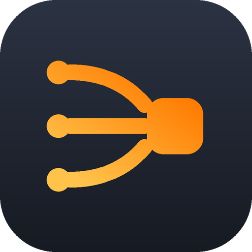

<div align="center">



</div>

# ZcodeAIModels

> **可见性**：公开 —— 凭据全部走环境变量，仓内**零明文凭据**；vendored 是 zai-org/ZCode（Apache-2.0）与 ZCodium（MIT）。第三方组件声明见 [NOTICE](NOTICE)。

**把模型供应商接进 ZCode 客户端的脚本与文档 —— 以 WorkBuddy2API 网关与 OpenCode-Go 套餐为例**

</div>

> **一句话**：这里放的是「**把模型接进 ZCode**」这一条线的全部脚本与文档 ——
> 探测哪些模型能用、走哪种协议、思考参数怎么关，再把结果写进 ZCode 的
> `provider_config.json`。
>
> **方法与供应商无关**：WorkBuddy2API 与 OpenCode-Go 是本仓跑通的**两个完整示例**；
> 接你自己的供应商，照「[通用方法](#connect-new-provider)」那四步做即可。

---

## 这是什么

一个**工具仓库**，不是一个应用。

它做三件事（**通用能力**，与具体供应商无关）：

1. **探测** —— 逐个模型试：能不能连、走哪种协议、工具调用能不能用、
   思考参数怎么关、还剩多少额度。
2. **同步** —— 把探测结论整理成 provider 分组（按成本档 / 积分倍率），
   写进 ZCode 客户端的 `provider_config.json`，让 ZCode 的模型列表里出现它们。
3. **记录** —— 把踩过的坑、模型的协议归属、关思考的参数矩阵固化成文档，
   下次换套餐、改网关、调规则时不用重新试一遍。

**它不改 ZCode 的代码，只改它的配置文件。** 全部副作用集中在
`~/.zcode/v2/provider_config.json` 一个文件（以及脚本自己产生的备份与缓存）。

### 通用能力 vs 本次实例

文档里每条结论都会标明它属于哪一类 —— 换供应商时照「通用能力」那一列做，
「本次实例」那一列是**随服务商变动的数据快照**（带采集时点）。

| 主题 | 通用能力（换供应商也成立） | 本次实例（随服务商变动） |
|---|---|---|
| 怎么判断模型走哪种协议 | 模型只认自己那一种协议，塞错上游直接拒 | OpenCode-Go 分 chat / messages / responses 三种；WorkBuddy 全是 OpenAI 兼容 |
| 怎么分 provider | 按成本档切，档内按单价（或倍率）升序 | WorkBuddy 按积分倍率切三档；OpenCode-Go 按「额度可撑输出」切六组 |
| ZCode 侧怎么配 | `provider_config.json` 里只有三个落点（见「与 ZCode 的关系」） | 本仓已配好 9 个 provider（六个 `opencode-go-*` + 三个 `workbuddy-*`） |
| 思考参数怎么关 | ZCode 内置通用规则无条件注入思考字段 → 用 `optionSpecs.reasoningLevel.map` 覆盖 | 具体哪个模型配空 map、哪个配 `{"thinking":{"type":"disabled"}}`，见参数矩阵 |
| 探测怎么打 | 必须用 ZCode 真实请求体、必须限速 | 限速值取决于对方的账号池大小（本仓示例：≥ 20 秒） |
| 数据 | —— | 价格、额度、倍率、实测速度（**带采集时点**的快照） |

**本仓的两个接入器**（`opencode-go/`、`workbuddy/`）就是照这套结构写的参照实现：
目录名带供应商名，是**刻意**的 —— 它们是示例，不是通用框架。

---

## 适用环境

| 项 | 值 |
|---|---|
| 客户端 | ZCode（Windows 桌面端） |
| 配置文件 | `~/.zcode/v2/provider_config.json`（Windows：`C:\Users\<你的用户名>\.zcode\v2\provider_config.json`）；可用环境变量 `ZCODE_PERSONAL_PROVIDER_CONFIG_FILE` 覆盖 |
| 运行时 | Python 3（**只用标准库**，无第三方依赖）+ Node.js（跑 `.js` 脚本） |
| 网络 | 能直连你的供应商。示例：直连 `opencode.ai`；WorkBuddy 侧需要本地网关 `wb2api` 在 `127.0.0.1:7863` 在跑（`WB_GATEWAY_BASE` 可覆盖） |
| 凭据 | **一律走环境变量**，见 [docs/SECRETS.md](docs/SECRETS.md)。示例：`OPENCODE_GO_KEY`（OpenCode-Go）、`WB_GATEWAY_KEY`（网关） |

> ⚠️ **凭据不要写进代码或文档。** 两个示例凭据分别从环境变量 **`OPENCODE_GO_KEY`**
> （OpenCode-Go 探测脚本）与 **`WB_GATEWAY_KEY`**（WorkBuddy）取；
> 接你自己的供应商时，按同样的模式加一个环境变量即可。
> **探测脚本里的明文 key 已全部删除**（见「已知坑」第 6 条），
> 未设置对应环境变量时脚本会**明确报错退出**。

---

## 快速开始

顺序不能乱：**先刷价格表 → 再探测 → 最后同步**。探测要慢（≥20 秒一个模型），
同步是秒级。

下面这条流水线**以本仓的两个示例供应商跑通一遍**。接别的供应商时：
第 1、2 步换成你自己的目录接口与探测脚本，第 3 步的**分档口径**按你的计价单位换；
**但第 3 步写 ZCode 配置的方式完全一样，不用改**。

### 0. 准备环境变量

```bash
export OPENCODE_GO_KEY='<OpenCode-Go api_key>'        # 跑 opencode-go/probe/ 下的脚本必填
export WB_GATEWAY_KEY='<网关 api_key>'                 # 仅 WorkBuddy 侧需要
export ZCODE_PERSONAL_PROVIDER_CONFIG_FILE="$HOME/.zcode/v2/provider_config.json"
```

> `opencode-go/probe/` 下的 5 个脚本（`probe_models.py`、`probe_protocols.py`、
> `bench_models.py`、`bench_clean.py`、`thinking-off-probe.js`）**都从
> `OPENCODE_GO_KEY` 读 key**；**没设就明确报错退出**，不会带着空 key 去请求。
> 当前值从 ZCode 的 `provider_config.json` 里取（脚本自己读同一份配置）。
> **接别的供应商**：照这个模式加一个自己的环境变量（名字、读取方写进
> [docs/SECRETS.md](docs/SECRETS.md) §3.5）。

### 1. 刷价格表（只有 WorkBuddy 侧需要）

```bash
# 抓网关价格表 → workbuddy/cache/wb_pricing.json
cd workbuddy
python workbuddy_fetch_pricing.py            # 写入（自动备份旧文件）
python workbuddy_fetch_pricing.py --dry-run  # 只看会变成什么样
#    字段含义见 docs/MODEL-PROVIDERS.md §4
```

OpenCode-Go 侧不需要这一步：`go_model_sync.py` 每次运行都会现拉
`/zen/go/v1/models` + 官方文档页的价格表。

### 2. 探测

```bash
# --- WorkBuddy：用 ZCode 真实请求体探测，间隔必须 >= 20 秒 ---
# （脚本按自身位置找数据文件，在哪个目录跑都行）
python workbuddy/workbuddy_probe_zcode.py --sleep 20
```

```bash
# --- OpenCode-Go：连通性 + 首字节延迟 ---
# 注意：这三个脚本把结果写到【当前工作目录】，跑完要手动归档
cd opencode-go/probe
python probe_models.py            # -> ./probe_results.json
node thinking-off-probe.js        # 只打印，不落盘
```

> 探测**必须用 ZCode 真实请求体**，不能拿裸 body 试 —— 网关会把 ZCode 注入的思考字段
> 原样转发给上游，裸 body 能通不代表 ZCode 能通。详见 [docs/PITFALLS.md](docs/PITFALLS.md) §2。

### 3. 同步进 ZCode

```bash
# 先不带 --apply 跑一遍，只出报告，看清楚要写什么
python opencode-go/ops/go_model_sync.py
python workbuddy/workbuddy_zcode_sync.py

# 确认无误再写
python opencode-go/ops/go_model_sync.py --apply
python workbuddy/workbuddy_zcode_sync.py --apply
```

两个脚本都会**先备份再原子替换** `provider_config.json`；ZCode 约 1 秒轮询该文件，
写完一般**不用重启客户端**。

---

<a id="connect-new-provider"></a>

## 通用方法：接一个新的模型供应商

**四步，与具体供应商无关。** 本仓的两个接入器（`opencode-go/`、`workbuddy/`）
就是照这套结构写的参照实现。

### 第 1 步：摸清接口面

先问清三件事 —— 答不上来就别写脚本：

| 要问的 | 为什么 | 本仓实例（示例） |
|---|---|---|
| 模型目录从哪个接口拿？ | 探测清单、价格表、分档都要它 | OpenCode-Go `/zen/go/v1/models`；WorkBuddy `/panel/api/models` |
| 每个模型走哪种协议？ | 塞错协议上游直接拒 | OpenCode-Go 分 chat / messages / responses 三种；WorkBuddy 全 OpenAI 兼容 |
| 怎么计价？ | 分档依据 | OpenCode-Go 按 $/M token；WorkBuddy 按积分倍率 |

### 第 2 步：取目录与价格，归一化成一张表

把目录接口的返回**归一化成一张价格表**（模型 id、单价 / 倍率、上下文、输出上限、
工具调用、思考档位、能否关思考）。归一化之后，**分档就是纯本地计算**，
换供应商只需换「取数 + 归一化」那一段。

- 参照实现（落盘）：`workbuddy/workbuddy_fetch_pricing.py` → `workbuddy/cache/wb_pricing.json`
- 参照实现（现拉现算，不落盘）：`opencode-go/ops/go_model_sync.py`

### 第 3 步：探测 —— 用 ZCode 真实请求体 + 限速

裸 body 能通 ≠ ZCode 能通（ZCode 会注入思考字段，上游不认就 400）。
探测必须先算出 ZCode **真实会发的 body** 再发出去；间隔要按对方的账号池规模定
（本仓示例：≥ 20 秒，太密会把账号池打爆）。

- 参照实现：`workbuddy/zcode_effective_body.js`（复刻引擎规则解析）+
  `workbuddy/workbuddy_probe_zcode.py`（失败再退 slim variant）

### 第 4 步：分档并写配置

- **分档**：按成本档切，档内按单价（或倍率）升序。档数与阈值由你的计价口径决定。
- **写配置**：只碰 `provider_config.json` 的三个位置（见下节「与 ZCode 的关系」），
  先备份再原子替换；写完等 1~2 秒看 ZCode 是否热重载。

### 换一个供应商要改什么

| 要改 | 不要改 |
|---|---|
| 探测脚本的 base URL 与凭据来源 | ZCode 配置的写入方式（三个落点） |
| 目录 / 价格的取数与归一化 | 思考参数覆盖机制（`optionSpecs.reasoningLevel.map`） |
| 分档口径与阈值 | 探测必须用真实 body、必须限速这两条原则 |
| providerId 与显示名 | —— |

---

## 目录结构

```
ZcodeAIModels/
├── README.md                  # 本文件：门面
├── AGENTS.md                  # 机器协议：PROGRESS 路径 / 凭据 / CodeGraph
├── CHANGELOG.md               # 更新日志（版本号在这里）
├── NOTICE                     # 第三方声明
├── LICENSE                    # MIT 许可证全文
├── .gitignore
├── PROGRESS.md                # 本仓唯一进度台账（追加式批次日志）
│
├── opencode-go/               # 示例接入器一：OpenCode-Go 套餐线
│   ├── ops/                   # 长期运维脚本
│   │   ├── go_model_sync.py           # 新模型自动收录（每天跑）
│   │   └── opencode-header-proxy.js   # 请求头注入代理（常驻）
│   └── probe/                 # 一次性探测脚本 + 结果快照
│       ├── probe_models.py / probe_protocols.py
│       ├── bench_models.py / bench_clean.py
│       ├── thinking-off-probe.js
│       ├── archive/validate_zcode_models.py
│       └── results/20261019/         # 探测原始结果（本地留存，不随仓库分发）
│
├── workbuddy/                 # 示例接入器二：WorkBuddy2API 网关线
│   ├── workbuddy_probe_zcode.py      # 用 ZCode 真实 body 探测
│   ├── workbuddy_zcode_sync.py       # 按积分倍率分三档写配置
│   ├── zcode_effective_body.js       # 复刻 ZCode 引擎规则，算真实请求体
│   ├── cache/                        # 活数据（本地留存）
│   ├── logs/                         # 探测日志（本地留存）
│   └── archive/                      # 已被取代的旧脚本 / 旧缓存
│
├── docs/                      # 文档（唯一索引见 docs/README.md）
│   ├── README.md / DOC-RULES.md / MODEL-PROVIDERS.md
│   ├── PITFALLS.md / TROUBLESHOOTING.md / MAINTENANCE.md
│   ├── UPSTREAM.md                   # 同类型开源项目调研（本仓能借鉴什么、为何没 vendor）
│   ├── 模型速查表.md                  # 早期速查（结论已并入 MODEL-PROVIDERS.md）
│   ├── archive/
│   └── release-notes/
│
├── third-party/               # 引入的上游项目（每份都带来源 URL + SHA + license + UPSTREAM.md）
│   ├── README.md                   # 统一索引：引了什么、为什么引、许可是否兼容
│   ├── zcode/                      # zai-org/ZCode（Apache-2.0）原样文件：规则数据 + 规则引擎源码
│   └── zcodium/                    # ZCodium（MIT）思考规则切片 + 本仓自写的漂移检查脚本
│
└── evidence/                  # 证据快照（网关目录、自动收录报告）
```

---

## 文件清单

> 下表列的是**两个示例接入器**的脚本。换供应商时照同样的结构加一份
> （见「[通用方法](#connect-new-provider)」）。

| 脚本 | 作用 | 输出产物 | 长期 |
|---|---|---|---|
| `opencode-go/ops/go_model_sync.py` | 四源并集检测 Go 套餐新模型 → 三协议探测 → 按成本档分组 → 写 `provider_config.json` | 报告 `go-model-sync-<时间戳>.md`；备份 `provider_config.json.bak-gosync-<时间戳>` | ✅ 长期 |
| `opencode-go/ops/opencode-header-proxy.js` | 给不支持自定义头的客户端（ChatBox / Open WebUI 等）补 `x-opencode-session` | 常驻 HTTP 代理，默认 `127.0.0.1:8787` | ✅ 长期 |
| `workbuddy/workbuddy_fetch_pricing.py` | 拉网关目录接口 → 归一化 → 写价格表（打印倍率变化 / 新增 / 下架摘要） | `workbuddy/cache/wb_pricing.json`（写前自动备份） | ✅ 长期 |
| `workbuddy/workbuddy_probe_zcode.py` | 用 **ZCode 真实 body** 探测网关模型可用性，可断点续跑 | `workbuddy/cache/wb_zcode_probe.json`；`workbuddy/logs/wb_zcode_probe.log` | ✅ 长期 |
| `workbuddy/workbuddy_zcode_sync.py` | 按积分倍率分免代 / 低代 / 高代三档写 provider | 备份 `provider_config.json.bak-wbproxy-<时间戳>` | ✅ 长期 |
| `workbuddy/zcode_effective_body.js` | 复刻 ZCode 引擎的规则解析顺序，算某 modelId **真实会发的请求体** | stdout JSON | ✅ 长期（`probe_zcode.py` 依赖它，必须同目录） |
| `opencode-go/probe/probe_models.py` | 34 个模型最小 token 连通性 + 首字节延迟 | `probe_results.json`（**写到当前工作目录**，需手动归档到 `results/<日期>/`） | ❌ 一次性 |
| `opencode-go/probe/probe_protocols.py` | 判定每个模型走哪种协议 | 只打印，不落盘 | ❌ 一次性 |
| `opencode-go/probe/bench_models.py` | 吞吐 + 工具调用基准 | `bench_results.json`（同上，需手动归档） | ❌ 一次性 |
| `opencode-go/probe/bench_clean.py` | 干净串行基准，每模型 3 采样 | `bench_clean.json`（同上，需手动归档） | ❌ 一次性 |
| `opencode-go/probe/thinking-off-probe.js` | 逐模型试「关思考」参数 | 只打印 | ❌ 一次性 |
| `opencode-go/probe/archive/validate_zcode_models.py` | 校验 ZCode 已配模型与其 provider 协议是否一致 | 只打印 | ❌ 一次性（已归档） |
| `workbuddy/archive/workbuddy_probe_models.py` | 早期裸 body 探测（已被 `workbuddy_probe_zcode.py` 完全取代） | — | ❌ 已归档 |
| `workbuddy/cache/wb_pricing.json` | 网关 56 个模型的倍率 / 上下文 / 输出上限 / effort 档位快照 | 由 `workbuddy_fetch_pricing.py` 生成 | ⚠️ 活数据 |
| `workbuddy/cache/wb_zcode_probe.json` | 探测结果缓存（status / variant / http / detail / rate） | 被 `workbuddy_zcode_sync.py` 读取 | ⚠️ 活数据 |
| `evidence/wb_panel_models.json` | 网关模型目录原始快照 | 只读证据 | — |
| `third-party/zcodium/reasoning-rules.js` | 按协议算「最小且正确」的思考字段；并比对本机 ZCode 内置规则与上游切片，报漂移 | stdout | ✅ 长期 |
| `third-party/zcodium/zcode-builtin-reasoning-rules.json` | ZCodium 内置思考规则的最小切片（4 条，逐字抄录，带来源 URL + SHA + license） | 只读参考 | ✅ 长期 |

一次性脚本的结论已固化进 [docs/MODEL-PROVIDERS.md](docs/MODEL-PROVIDERS.md)，
**不用重跑**；要重跑先改源码里的模型清单。

---

## 与 ZCode 的关系

本仓库**不含 ZCode 客户端**，只读写它的配置文件。

### 改的是哪三处

`provider_config.json` 里脚本只碰三个位置：

| JSON 路径 | 内容 |
|---|---|
| `config.providerConfigRules.providerRules[]` | provider：显示名、协议 `api.type`、`api.baseUrl`、`personalModelIds`、`modelOrder` |
| `config.modelConfigRules.providerModelRules[]` | 模型级规则：`enabled`、`properties`（上下文 / 工具 / 图片）、`optionSpecs`（思考覆盖、最大输出） |
| `config.providerOrder[]` | provider 在界面里的先后顺序 |

### ZCode 会热重载吗

**会。** ZCode 约 1 秒轮询 `provider_config.json`，脚本写完后一般不需要重启客户端。
但有一条硬约束：**写配置期间不要在 ZCode 的 provider 设置界面里同时改** ——
界面保存时会整份写回，把脚本刚写进去的东西覆盖掉。

### `--apply` 的风险

| 脚本 | 行为 | 风险 |
|---|---|---|
| `go_model_sync.py --apply` | 只**追加**新模型 + 改一个 provider 显示名（"备用"→"响应"） | 低。已有模型顺序可能被追加到组尾 |
| `workbuddy_zcode_sync.py --apply` | **整条替换** `workbuddy-free/low/high` 三个 provider 及其全部模型规则 | 中。这三个 provider 上你手工加的模型会被冲掉；其它 provider 不受影响 |

两者都会先做 `.bak-*` 备份再原子替换；回退方式见
[docs/MAINTENANCE.md](docs/MAINTENANCE.md) §4。

---

## 已知坑

完整清单见 [docs/PITFALLS.md](docs/PITFALLS.md)，这里只列最容易踩的：

1. **ZCode 内置通用规则无条件发思考字段** → 上游不认就 400。解法是给模型配空 map 覆盖。
   想少发字段（只发该协议认的那几个）用 `node third-party/zcodium/reasoning-rules.js map --api-type=... --effort=...`；
   想知道内置规则有没有变用 `node third-party/zcodium/reasoning-rules.js check`（详见 [docs/UPSTREAM.md](docs/UPSTREAM.md) §4）。
2. **`modelMatch` 是全匹配正则** `^(?:pattern)$` —— 想匹配前缀要自己写 `.*`。
3. **规则按序叠加、后者胜** —— 通用规则写在前面，专属规则写在后面才盖得住。
4. **探测必须用 ZCode 真实 body，且间隔 ≥ 20 秒** —— 否则「curl 能通但 ZCode 400」，
   或者把网关账号池打爆（`no_healthy_account`）。
   *（间隔的具体数值取决于对方的账号池大小；本仓示例是 4 个号的池子，故 ≥ 20 秒。）*
5. **免费池日配额耗尽会返回 429**，`Retry-After` 落在次日 00:00 UTC ——
   这不是配置错，也不是模型下线，**等到次日再试**。
6. ⚠️ **探测脚本的 API key 已改为环境变量读取** —— `opencode-go/probe/` 下的 5 个脚本
   （`probe_models.py`、`probe_protocols.py`、`bench_models.py`、`bench_clean.py`、
   `thinking-off-probe.js`）里的明文 `oc_sk_…` **已全部删除**，改为读
   **`OPENCODE_GO_KEY`**；**未设置时明确报错退出**（不会带着空 key 去请求，
   再拿一个含义不明的 401 当结果）。**接别的供应商照这个模式做**。
7. ⚠️ **`go_model_sync.py` 的 ZCode 配置路径默认值按「当前用户主目录」推导**，
   可用 `--config` 覆盖；它**不读** `ZCODE_PERSONAL_PROVIDER_CONFIG_FILE`（已知缺口，见
   [docs/SECRETS.md](docs/SECRETS.md) §3.4）。
   报告目录同理：从脚本自身位置推导本仓 `evidence/`，可用 `GO_SYNC_REPORT_DIR` 覆盖。

---

## 记忆文档

`memories/` —— **只靠读代码和文档读不出来的事实**：踩过的坑、根因、实测结论、
已确认但未修的缺陷。同样的内容也存在于 ZCode 的记忆库（按项目 id 分目录），
那里是活的，这里是**随 git 版本化的快照**。

索引见 [memories/MEMORY.md](memories/MEMORY.md)，约定见
[memories/README.md](memories/README.md)。

## 免责声明

本项目仅供学习与个人使用。

- 本仓库**不上传、不收集任何数据**；所有脚本只与你自己机器上的配置和你自己的
  模型网关交互。
- 脚本会修改**你自己的** ZCode 配置文件。写之前请备份（脚本也会自动备份）。
- 本仓示例涉及的 `opencode.ai` 与 WorkBuddy2API，以及**你自行接入的其它供应商**，
  都是**第三方服务**，本项目与它们不存在任何隶属、合作、授权或认可关系。
  模型价格、额度、可用性、隐私策略（部分模型会用请求数据训练）
  **一律以服务商当时的说明为准**，本仓库的文档只是某一时刻的快照。
- 本仓库的模型清单与分组是**按成本档 / 积分倍率**排的，是主观取舍，不是推荐。
- 使用本项目产生的任何后果由使用者自行承担。

---

## 开源鸣谢

本仓库建立在这些项目与服务之上（详见 [NOTICE](NOTICE)）：

| 项目 / 服务 | 用途 | 许可证 / 条款 |
|---|---|---|
| [**WorkBuddy2API Panel**](https://github.com/linguo2625469/workbuddy2api-panel)（原作者 [Sliverkiss/workbuddy2api](https://github.com/Sliverkiss/workbuddy2api)） | 腾讯 CodeBuddy 多账号网关，本仓库的 WorkBuddy 侧全部请求都发给它 | MIT（**本仓库不含其源码**，只通过 HTTP 调用） |
| **OpenCode Zen / Go**（opencode.ai） | 模型套餐与 API 网关，本仓库的 OpenCode-Go 侧全部请求都发给它 | 商业服务，条款见 opencode.ai |
| [**ZCode**](https://github.com/zai-org/ZCode) | 目标客户端，本仓库改它的配置并复刻它的请求体语义 | Apache-2.0（2026-09-21 已开源）。**`third-party/zcode/` 随仓分发它的 4 个原样文件**（规则数据 + 规则引擎源码），见 [third-party/zcode/UPSTREAM.md](third-party/zcode/UPSTREAM.md) |
| [**ZCodium**](https://github.com/ZCodium-project/ZCodium) | ZCode 的 MIT 授权独立审计 fork；本仓库从它抄了一份思考规则最小切片作为源码依据 | MIT —— `third-party/zcodium/` |
| **Python 3** / **Node.js** | 脚本运行时 | PSF License / MIT |

### 调研过并借鉴的同类型开源项目

调研结论见 [docs/UPSTREAM.md](docs/UPSTREAM.md)（含每个项目的 star / 体积 / license /
与本仓的重叠与差异 / **本仓能借鉴什么** / **为什么没有 vendor 它的代码**）。

| 项目 | 借鉴了什么 | 许可证 |
|---|---|---|
| [**soulvon/AnyBridge**](https://github.com/soulvon/AnyBridge) | 「按协议只发该协议认的思考字段」的映射表；托管 providerId + 只写自己管的字段 | MIT |
| [**12errh/zen-proxy**](https://github.com/12errh/zen-proxy) | 同一上游（opencode.ai）的会话头与会话 id 铸造；错误分级 → 重试还是降级；降级链末端要还原成客户端要的那个模型 | MIT |
| [**hkqr/my-free-code**](https://github.com/hkqr/my-free-code) | 档位 → 候选序列 → 逐个降级；按供应商的并发 / 速率窗口 / 健康退避三元组 | MIT |
| [**ZCodium-project/ZCodium**](https://github.com/ZCodium-project/ZCodium) | ZCode 内置思考规则的**可引用源码依据**（本仓已抄一小片，见 `third-party/zcodium/`） | MIT |
| [**musistudio/claude-code-router**](https://github.com/musistudio/claude-code-router) | 从上游目录读「支不支持推理 / 支持哪几档」的思路 | MIT |
| [**mozilla-ai/otari**](https://github.com/mozilla-ai/otari) | 虚拟密钥 + 按 key 限预算（将来做共享网关时的方向） | Apache-2.0 |
| [**decolua/9router**](https://github.com/decolua/9router) | 免费模型路由 + 自动降级 | MIT |
| [**ZepiGit/ZCode-Agent-Kit**](https://github.com/ZepiGit/ZCode-Agent-Kit) | `EFFORT_MAPPING.json` 交叉验证了本仓记录的思考档位 | MIT |
| [**xhwxt/zcode-token-usage-statusbar**](https://github.com/xhwxt/zcode-token-usage-statusbar) / [**techysy/CreditDaddy**](https://github.com/techysy/CreditDaddy) | ZCode 生态的用量展示与账号运营做法（只读参考） | MIT |

> **没有复制代码的项目也要鸣谢** —— 上表全部列在这里，
> 逐项的来源 URL / commit SHA / license 见 [NOTICE](NOTICE)。
> 本仓**实际复制**的只有三处：
> ① `third-party/zcodium/zcode-builtin-reasoning-rules.json`（ZCodium 规则切片，逐字）；
> ② `third-party/zcodium/reasoning-rules.js`（本仓自己写的实现，只借鉴思路）；
> ③ `third-party/zcode/` 下 zai-org/ZCode 的 **4 个原样文件**（规则数据 + 规则引擎源码，Apache-2.0）——
> 它们让本仓能离线复刻客户端的请求体语义，来源凭证见
> [third-party/zcode/UPSTREAM.md](third-party/zcode/UPSTREAM.md)。
> **AGPL 项目（`zcode2api` 两家）与无 LICENSE 项目（`zcode-api`）只读不抄。**

---

## 参与与治理

- [CONTRIBUTING.md](CONTRIBUTING.md) —— 怎么跑、**怎么接一个新供应商**、凭据只走环境变量这条硬规矩
- [SECURITY.md](SECURITY.md) —— 安全问题怎么报、探测脚本的速率与影响面
- [tools/check-docs.py](tools/check-docs.py) —— 文档自检（链接 / 锚点 / 引言块 / 孤儿），CI 里跑的就是它
- CI：`.gitlab-ci.yml`（Python 语法 + Node 语法 + 文档自检）

---

## 许可证

本项目以 **MIT License** 发布 —— 许可证全文见 [LICENSE](LICENSE)。
第三方组件与服务的版权与条款声明见 [NOTICE](NOTICE)。
